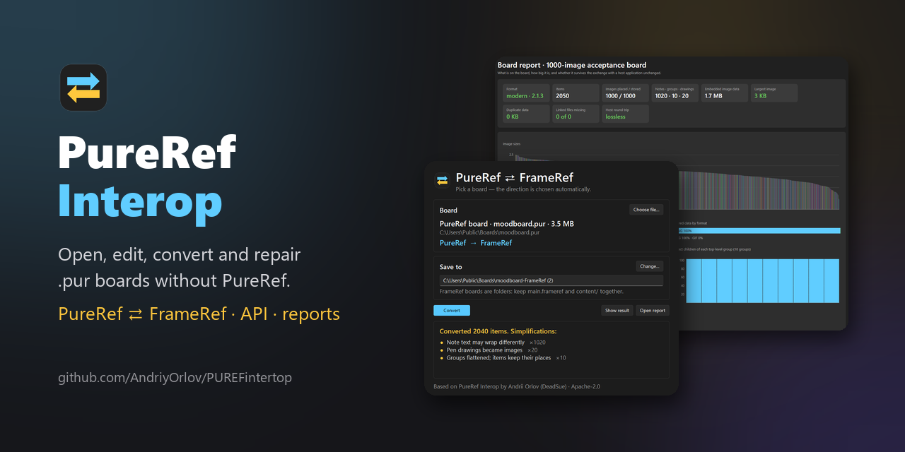

<p align="center">
  
</p>

<h3 align="center">Open, edit, convert and repair PureRef boards without PureRef</h3>

<p align="center">
A Python library, a command-line tool and a one-click Windows converter for PureRef <code>.pur</code> files:
read and write boards, move them to and from <b>FrameRef</b>, recover damaged files and see what is inside
a board at a glance.
</p>

<p align="center">
  <a href="https://github.com/AndriyOrlov/PUREFintertop/releases/tag/converter-2026-10-14"></a>
  <a href="https://send.monobank.ua/jar/7AVDtzYypi"></a>
</p>

<p align="center">
  <a href="LICENSE"></a>
  
  
  
  
</p>

<h4 align="center">
  <a href="#-features">Features</a> ·
  <a href="#-screenshots">Screenshots</a> ·
  <a href="#-install">Install</a> ·
  <a href="#-converter">Converter</a> ·
  <a href="#-python-and-command-line">Python and CLI</a> ·
  <a href="#-tested-against-pureref">Tested</a> ·
  <a href="#%EF%B8%8F-support">Support</a>
</h4>

> [!NOTE]
> **Preview.** Every feature is covered by automated tests and checked against the real PureRef 2.1.3
> (and the Linux builds of 1.10.4, 1.11.1 and 2.0.3). Testing on large real-world boards is in progress:
> work on copies and keep the originals.

## ✨ Features

| | |
|---|---|
| 🔁 **PureRef ⇄ FrameRef** | One-click Windows converter in both directions for native FrameRef boards (file_version 2). Positions, rotation, mirroring, opacity, layer order, locks, grayscale and notes carry over; anything simplified is listed in a report. |
| 📂 **Read and write `.pur`** | PureRef 2.x (format 2.1) and 1.x (format 1.10): images, rich-text notes, groups, pen drawings, comments, crops, flips, filters, GIF frames. An unedited board is saved byte for byte, and data a newer PureRef adds is kept. |
| 📊 **Board report** | One HTML page per board: graded summary tiles, image sizes tinted with each image's colour, pixel sizes against Full HD and 4K, formats, groups, a preview and a lossless round-trip check. |
| 🩹 **Repair** | A broken checksum is fixed outright, a damaged database is salvaged row by row, and as a last resort pictures are cut straight out of the file. |
| 🔗 **Linked images** | Find images that are only file paths, relink moved files (checksum-verified) and embed them so a board works on any PC. |
| 🧰 **Board tools** | Merge, split by group, remove duplicate images, arrange in a grid, search names, comments and note text, shrink PNGs without quality loss. |
| 🖼️ **Render and thumbnails** | Draws whole boards to PNG; an edited board gets a fresh 256×256 thumbnail, the way PureRef writes it. |
| 🐘 **Huge boards** | Boards over 32 MB are worked through a temporary file: a 1.49 GB board opens, edits and saves with a 34 MB memory peak. |
| 🔄 **Exchange format** | A documented JSON + assets package with a JSON Schema for any app that wants to read or write PureRef boards, plus a language-neutral test suite for its own reader. |
| 🛡️ **Safe by design** | Originals are never changed, outputs are never overwritten, and unknown or suspicious files are refused instead of guessed. |

## 📸 Screenshots

<p align="center">
  
  
</p>

<p align="center">
  
  
</p>
<p align="center"><sub>Open/save time and peak memory against board size (<code>tools/benchmark.py</code>, Windows 11).</sub></p>

## 📦 Install

**Converter, no Python needed:** download `PureRef-FrameRef-Converter.exe` from
[Releases](https://github.com/AndriyOrlov/PUREFintertop/releases/tag/converter-2026-10-14) and run it. `pur-adapter.exe` is the full command-line tool in one file.

**Python library** (3.11 or newer; the only dependency is Pillow):

```powershell
py -3.12 -m venv .venv
.venv\Scripts\python -m pip install -r requirements.txt
.venv\Scripts\python -m pip install --no-deps .
```

On Linux and macOS use `python3` and `.venv/bin/python`.

## 🔁 Converter

1. Run `PureRef-FrameRef-Converter.exe`, or drop a `.pur` / `main.frameref` onto its icon.
2. **Choose file…** picks the board; the direction and a new output name are chosen for you.
3. **Convert.** Green means nothing was simplified, yellow lists the simplifications, red explains why a
   board could not be converted. The original is never touched.

A FrameRef board is a folder (`main.frameref` + `content/`): move it as a whole. Details, limits and the
command-line form are in [docs/CONVERTER.md](docs/CONVERTER.md).

## 🐍 Python and command line

```python
from pur_adapter import Board

with Board.load("board.pur") as board:
    image_id = board.add_image("reference.png", x=100, y=200)
    board.update(image_id, rotation=15, scale=0.8, comment="hero shot")
    board.configure_image(image_id, crop=(0, 0, 200, 120), flip_horizontal=True)
    board.save("edited.pur")
```

```powershell
pur-adapter report board.pur report.html        # tiles, charts, round-trip check
pur-adapter render board.pur preview.png
pur-adapter repair broken.pur recovered-folder
pur-adapter merge a.pur b.pur --output both.pur
pur-adapter relink board.pur fixed.pur --search D:\References
pur-adapter export-package board.pur package    # JSON + assets for another app
pur-adapter create package/board.json new.pur   # and back
```

Every command prints JSON and never overwrites without `--overwrite`. All commands and functions:
[API reference](docs/API.md) · [exchange format](docs/INTEGRATION.md) ·
[JSON Schema](docs/manifest.schema.json).

## ✅ Tested against PureRef

* **112 automated tests**, including damaged files, Unicode, huge boards and both converter directions.
* **The real PureRef 2.1.3** opened, rendered and resaved boards written by this project without warnings;
  measured behaviour (thumbnails, image formats, EXIF photos, stacking, note sizes) is in
  [docs/NATIVE_WINDOWS.md](docs/NATIVE_WINDOWS.md).
* **1000-image board:** shuffled and restored exactly; PureRef draws the original and the restored board
  pixel for pixel the same ([details](docs/THOUSAND_BOARD.md)).
* **[Conformance suite](conformance/README.md):** ten boards with the expected result for each and seven
  damaged files, so any other `.pur` reader can check itself.

Format notes: [docs/FORMAT.md](docs/FORMAT.md) · [research](docs/research/README.md) ·
[roadmap](docs/ROADMAP.md) · [real-board test plan](docs/REAL_BOARD_TEST_PLAN.md).

**Current limits:** previews approximate PureRef's text layout; perspective transforms and linked images
cannot go to PureRef 1.x or FrameRef; FrameRef video, PDF and portals are not converted yet; macOS has not
been checked.

## 🛠 Build

```powershell
.venv\Scripts\python -m unittest discover -s tests
.venv\Scripts\python -m pip install pyinstaller sv-ttk
.venv\Scripts\python -m PyInstaller --noconfirm PureRef-FrameRef-Converter.spec
```

`tools/make_banner.py` and `tools/make_converter_icon.py` redraw the banner and the icon. Pushing a
`v*` tag builds both EXEs and attaches them to a release.

## 🔗 Related

* [HDRDisplayCalibrate](https://github.com/AndriyOrlov/HDRDisplayCalibrate): SDR and HDR display
  calibration for Windows with an ordinary colorimeter.
* [AmbientLightCalibrate](https://github.com/AndriyOrlov/AmbientLightCalibrate): monitor brightness
  matched to room light.

## 🤖 Use by AI and LLMs

[llms.txt](llms.txt) gives a short map of the code. AI training and AI-generated code are welcome as long
as the NOTICE is kept and the project is credited (see License).

## ❤️ Support

If PureRef Interop is useful to you, you can support its development:

<table>
  <tr>
    <td><a href="https://send.monobank.ua/jar/7AVDtzYypi"></a></td>
    <td>
      <b>Monobank jar:</b> <a href="https://send.monobank.ua/jar/7AVDtzYypi">send.monobank.ua/jar/7AVDtzYypi</a><br>
      <b>Jar card number:</b> <code>4874 1000 3425 0244</code><br><br>
      A ⭐ on GitHub and a mention in your videos or posts help just as much. Thank you!
    </td>
  </tr>
</table>

## 📄 License and credit

Apache License 2.0, see [LICENSE](LICENSE) and [NOTICE](NOTICE). You may use, change and redistribute it,
including commercially and in AI training or AI-generated code, as long as you keep the NOTICE and credit
**"Based on PureRef Interop by Andrii Orlov (DeadSue)"**.

The bundled PureRef 1.x codec by Fyor keeps its MIT license ([third_party](third_party/NOTICE.md)).
PureRef and FrameRef belong to their respective developers; this project is independent of both and does
not include their software.
