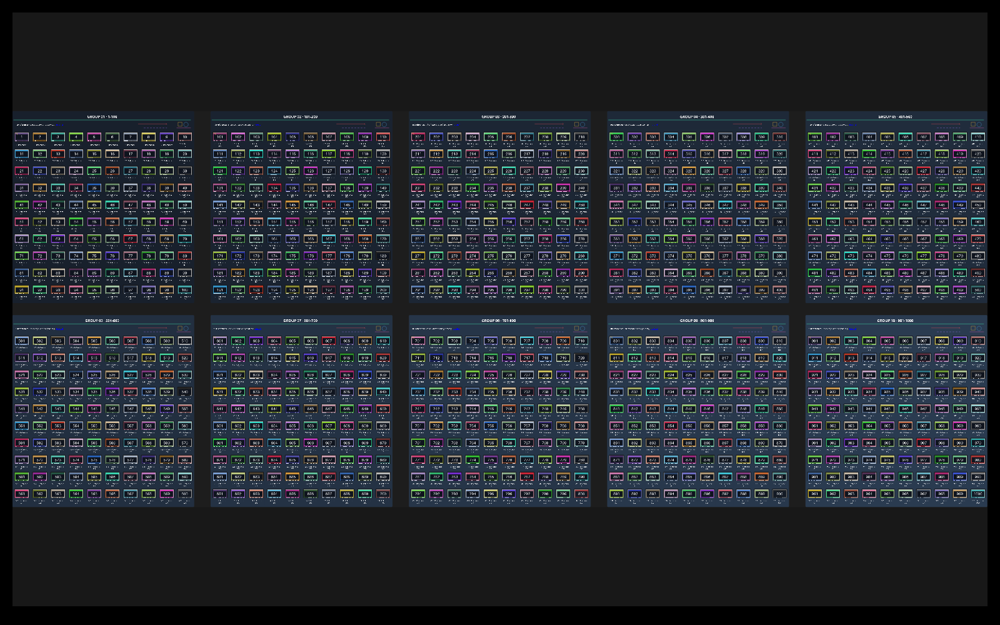
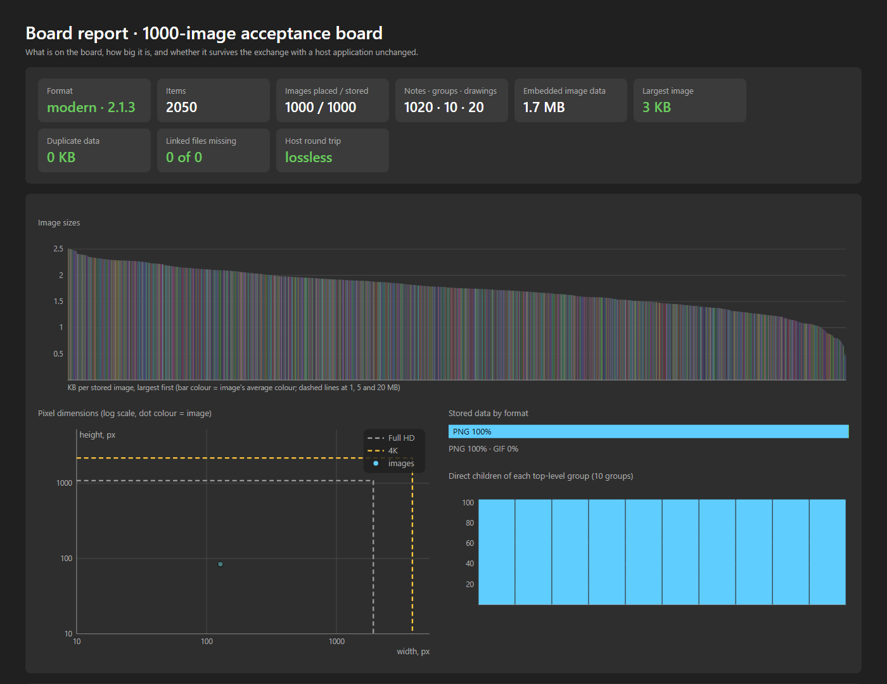
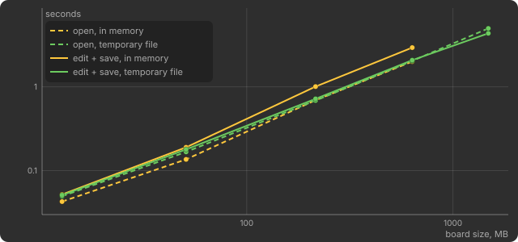
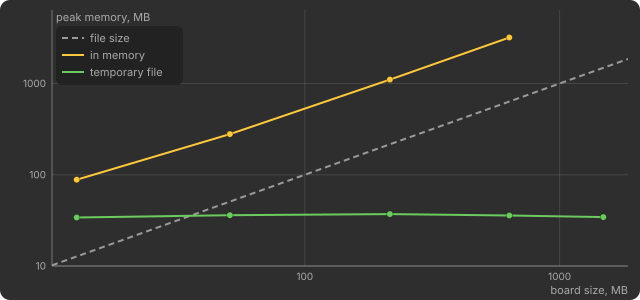
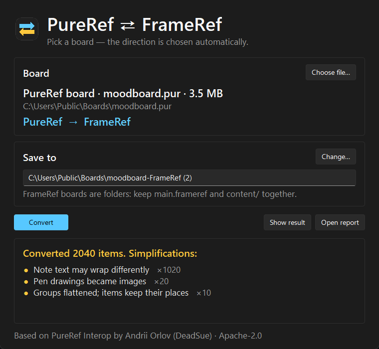

# PureRef Interop

A local document API and compatibility bridge by **Andrii Orlov / Dead_Sue**.
It reads, creates, edits and repairs `.pur` boards without launching PureRef.
Covered releases: **1.10.4, 1.11.1, 2.0.3 and 2.1.3** (Linux research builds,
plus the Windows 2.1.3 build for the 0.3 checks).

This is a prototype for real-board testing and a future integration proposal to
Polygonflow. It is not an installed FrameRef plugin. The original manifest bridge
uses neutral JSON plus assets; the standalone converter additionally reads and
writes native FrameRef JSON boards (file_version 2). A language-neutral
[conformance suite](conformance/README.md) lets a host check its PureRef reader.

## Validation and research

- **1000-image acceptance board**: numbered images with captions in ten groups,
  all 1000 shuffled and restored exactly; PureRef 2.0.3 and 2.1.3 render the
  original and the restored board pixel for pixel the same.
- **Native checks on Windows 2.1.3**: thumbnails, scene rectangle, image format
  names, EXIF photos, stacking rules, crops with flips, note sizes, what PureRef
  changes when it resaves a board ([results](docs/NATIVE_WINDOWS.md)).
- **Conformance suite**: ten boards with expected descriptions, seven damaged
  files with expected errors, and PureRef resaves showing the scene survives.
- **Large boards**: a 1.49 GB board opens, is edited and saved with a 34 MB
  peak memory use (see the charts below).
- The automated suite passes **112 tests**.

More: [1000-image boards](docs/THOUSAND_BOARD.md),
[common scene core](docs/CORE.md),
[format evolution](docs/research/VERSION_RESEARCH.md),
[roadmap status](docs/ROADMAP.md).



## Charts and reports

`pur-adapter report board.pur report.html` writes a self-contained page in the
style of the HDRDisplayCalibrate verification report: graded summary tiles
(green / yellow / red), image sizes as bars tinted with each image's average
colour, pixel dimensions against Full HD and 4K, data by format, group sizes,
a preview and a table. The **host round trip** tile exports the board to the
FrameRef JSON and back and lists anything that did not survive.

<p align="center">
  
</p>

Open and save time, and peak memory, against board size
(`python tools/benchmark.py`, Windows 11, Python 3.12). Above 32 MB boards are
opened through a temporary file, so memory stays flat:

<p align="center">
  
  
</p>

## Windows converter

[PureRef ⇄ FrameRef converter](docs/CONVERTER.md): one EXE that converts
boards both ways between PureRef and native FrameRef (file_version 2). Choose a
board (or drop it on the program icon), check the suggested output and click
**Convert**; the result lists every simplification, grouped. FrameRef output is
a folder with `main.frameref` and `content/`; move that folder together.

<p align="center">
  
</p>

## Install

**Without Python:** download `pur-adapter.exe` from a GitHub release (built by
`.github/workflows/release.yml`) and use the commands below.

**With Python** 3.11 or newer (3.12 is tested). The only external runtime
package is Pillow; SQLite is part of Python.

```powershell
py -3.12 -m venv .venv
.venv\Scripts\python -m pip install -r requirements.txt
.venv\Scripts\python -m pip install --no-deps .
.venv\Scripts\python -m unittest discover -s tests -v
```

On Linux/macOS use `python3` and `.venv/bin/python`. See
[dependencies](docs/DEPENDENCIES.md) for runtime versus research tools.

## Python API

```python
from pur_adapter import Board

with Board() as board:
    image_id = board.add_image("reference.png", x=100, y=200)
    board.add_note("Check the indirect lighting", x=450, y=100)
    board.save("created.pur")

with Board.load("created.pur") as board:
    board.update(image_id, x=180, rotation=15, scale=0.8, comment="hero shot")
    board.configure_image(image_id, crop=(0, 0, 200, 120), flip_horizontal=True)
    print(board.image_settings(image_id))
    board.save("edited.pur")
```

`x` and `y` are item-local coordinates, relative to the parent when present.
Images are centred on the item origin. Positive y points down. `get(id)` returns
an immutable snapshot; use `update()` for changes. Saving an edited board also
refreshes its 256×256 thumbnail, as PureRef does.

Exchange with a host such as FrameRef:

```python
from pur_adapter.manifest import export_manifest, import_manifest
from pur_adapter.sidecar import read_sidecar, write_sidecar

with Board.load("existing.pur") as board:          # PureRef -> host
    extensions, _ = read_sidecar(board, "existing.pur")
    export_manifest(board, "package", extensions=extensions)

board, report = import_manifest("package/board.json")  # host -> PureRef
with board:
    board.save("from-host.pur")
    write_sidecar(board, "from-host.pur", report["extensions"], host="FrameRef")
```

See the [integration contract](docs/INTEGRATION.md) and the
[API reference](docs/API.md).

## Command line

```powershell
pur-adapter inspect board.pur
pur-adapter render board.pur preview.png --width 2048
pur-adapter report board.pur report.html                    # charts, tiles, round-trip check
pur-adapter create package/board.json created.pur          # host JSON -> .pur
pur-adapter export-package board.pur package                # .pur -> host JSON
pur-adapter patch board.pur edited.pur --item 0 --set '{"x":200,"rotation":15}'
pur-adapter export-legacy board.pur for-pureref-1.pur       # flattened, with a report
pur-adapter repair broken.pur recovered-folder
pur-adapter merge a.pur b.pur --output both.pur
pur-adapter split board.pur one-board-per-group
pur-adapter arrange board.pur tidy.pur --sort name
pur-adapter search board.pur "lighting"
pur-adapter linked board.pur
pur-adapter relink board.pur fixed.pur --search D:\References
pur-adapter embed board.pur self-contained.pur
pur-adapter shrink board.pur smaller.pur
pur-adapter dedupe board.pur deduped.pur
pur-adapter rasterize drawing.pur rasterized.pur --all --scale 4
pur-adapter extract-assets board.pur original-files
```

Commands print JSON. Errors go to stderr with exit code 1. Existing outputs are
never overwritten unless the command receives `--overwrite`.

## What is supported

- Modern format `2.1` (PureRef 2.0.3 and 2.1.3) and legacy `1.10` (1.10.4, 1.11.1).
- Images: embedding (format names and EXIF-rotated sizes as PureRef stores
  them), crop, flips, grayscale, smoothing, animation frame and speed, opacity.
- Notes with HTML text and style, nested groups with colour and lock mode,
  comments, locks, z order, sibling order, native pen drawings (solid, dashed,
  arrow, curves; rectangles and ellipses are stored as paths).
- Unknown native columns and tables survive ordinary edits; an unedited board
  is saved byte for byte.
- Lossless JSON exchange (schema 2) with FrameRef media mapping and a sidecar
  file for host-only data, which PureRef itself would delete.
- Rendering, thumbnails, repair of damaged files, linked-image relinking and
  embedding, lossless PNG shrinking, merge, split, de-duplicate, arrange, search.
- Explicit compatibility export to 1.x with a report of every simplification.

## Current limits

- Rendering approximates PureRef: text layout and antialiasing differ and
  perspective is drawn as affine. It is meant for thumbnails and checks.
- PureRef rewrites sibling sort keys when it saves; their purpose is not
  established. Drawing order comes from `z` and is preserved.
- Compatibility (1.x) export stops on crops, nondefault image flags, perspective
  and linked images, which need pre-rendered previews.
- Repair finds large modern images only while the database is readable; cutting
  pictures from raw bytes works best for small and legacy images.
- Native verification covered Linux (all four releases) and Windows (2.1.3).
  macOS has not been checked.

[Native evidence](docs/VALIDATION.md),
[Windows checks](docs/NATIVE_WINDOWS.md),
[format notes](docs/FORMAT.md),
[binary research](docs/research/README.md),
[real-board test plan](docs/REAL_BOARD_TEST_PLAN.md),
[Claude review brief](docs/CLAUDE_REVIEW.md).

## License

Apache License 2.0, see [LICENSE](LICENSE) and [NOTICE](NOTICE). Copyright 2026
Andrii Orlov (DeadSue). Forks, derivative works and AI-generated code based on
this project must keep the NOTICE file and credit "Based on PureRef Interop by
Andrii Orlov (DeadSue)". The bundled legacy codec by Fyor keeps its MIT license
([third_party](third_party/NOTICE.md)).

## Next steps

1. Andrii tests copies of real boards and records differences.
2. Agree with Polygonflow on the host API and feature mapping, using the
   conformance suite as the shared reference.
3. Prepare the proposal letter. Send only after Andrii's final check.

No proposal email has been sent.
