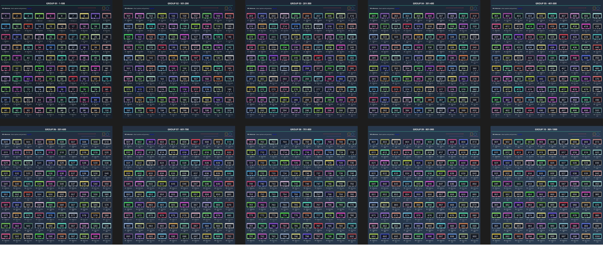
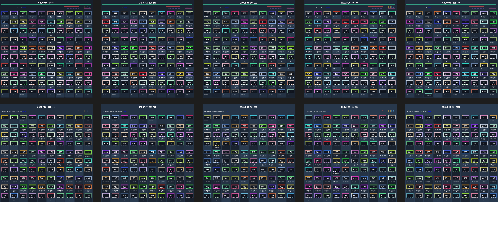

# 1000-image acceptance board

Rebuilt and verified on 2026-10-14. The committed artifacts are in
[`validation/thousand`](../validation/thousand/).

| Artifact | Purpose |
|---|---|
| [ordered.pur](../validation/thousand/ordered.pur) | Numbers 1–1000, ten groups of 100, every image captioned |
| [shuffled.pur](../validation/thousand/shuffled.pur) | All 1000 image positions and group assignments shuffled by code |
| [restored.pur](../validation/thousand/restored.pur) | Original hierarchy, transforms, z and ordering restored exactly |
| [compatible-legacy.pur](../validation/thousand/compatible-legacy.pur) | Explicit simplified 1.x export |
| [layout.json](../validation/thousand/layout.json) | Guarded original layout snapshot |
| [result.json](../validation/thousand/result.json) | API counts, content guard, shuffle and restore results |
| [native-result.json](../validation/thousand/native-result.json) | Native render equality and native resave verification |
| [compatible-legacy-report.json](../validation/thousand/compatible-legacy-report.json) | Each simplification reported |

The modern scene contains 1000 unique embedded assets, 1000 captions, twenty
group headings/annotations and twenty drawings: **2050 items**. Number 1000 is a
two-frame GIF. Every hundredth image is locked with 0.85 opacity. Groups use
different backgrounds and alternating selection lock modes. Annotations include
rich text and links; drawings include solid, dashed, arrow, rectangle and ellipse
geometry. Parent-child relationships keep captions and small marks with images.

The shuffled board moves all 1000 images using seed 20261014. Restore checks a
content hash before applying the original layout. It preserves resource bytes,
captions, drawings and the original source file. Reopening the restored file
passes all image, group, caption and position checks.

## Native evidence

The official Linux PureRef 2.0.3 and 2.1.3 executables opened and exported each
modern board. For **each release independently**, ordered and restored RGB pixels
are identical. The native applications also saved a new canonical `.pur`; the
adapter reopened each and verified the full 1000-image structure.

PureRef 2.0.3 exports a different aspect ratio from 2.1.3 and predates the newer
ellipse/rectangle tool UI. Cross-version pixel identity is not claimed.

Native PureRef 2.1.3 ordered board:



Native PureRef 2.1.3 shuffled board:



Native application UI captures: [ordered](screenshots/thousand-ordered-ui-2.1.3.png),
[shuffled](screenshots/thousand-shuffled-ui-2.1.3.png),
[restored](screenshots/thousand-restored-ui-2.1.3.png).
These are separate from the native scene exports used for exact comparison.

## Reproduce

After installing the adapter, generate into a **new directory**:

```sh
python tools/run_thousand.py /tmp/pur-thousand-new --seed 20261014
python -m unittest discover -s tests -v
python tools/research/compare_versions.py
python tools/verify_native.py --program /path/to/PureRef --release 2.1.3 \
  --boards /tmp/pur-thousand-new --output /tmp/pur-native-new
```

Linux native checks need a working X display, X11 libraries and the executable's
bundled Qt library/plugin paths. PureRef is not required for adapter API tests.
The suite passes **44 tests** on Python 3.12.14 and Pillow 12.3.0.

## Compatibility scope

The 1.x export flattens groups, converts comments into notes and drawings into
positioned transparent PNGs, selects an animation frame, bakes opacity and
discards locks with a report. It has 1020 images and 1030 notes. This is lossy
interchange, not identical rendering or preservation of editable vector pens.
Pillow approximates native Qt pen antialiasing and dashed/arrow rendering.

This case exercises the implemented persistent scene features. It does not
certify every PureRef GUI command, every legacy record, linked-resource recovery,
all metadata/view state or future versions. Crop/flip/grayscale/filter/frame APIs
have separate tests. Real user boards and Claude review remain required before
the Polygonflow proposal; no proposal has been sent.
