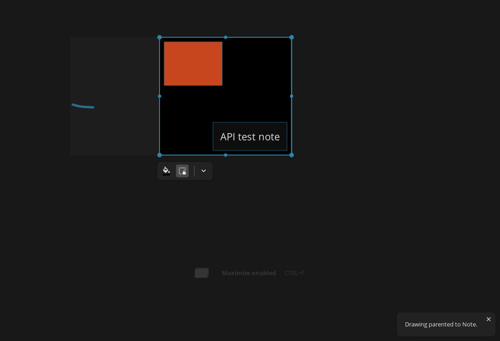
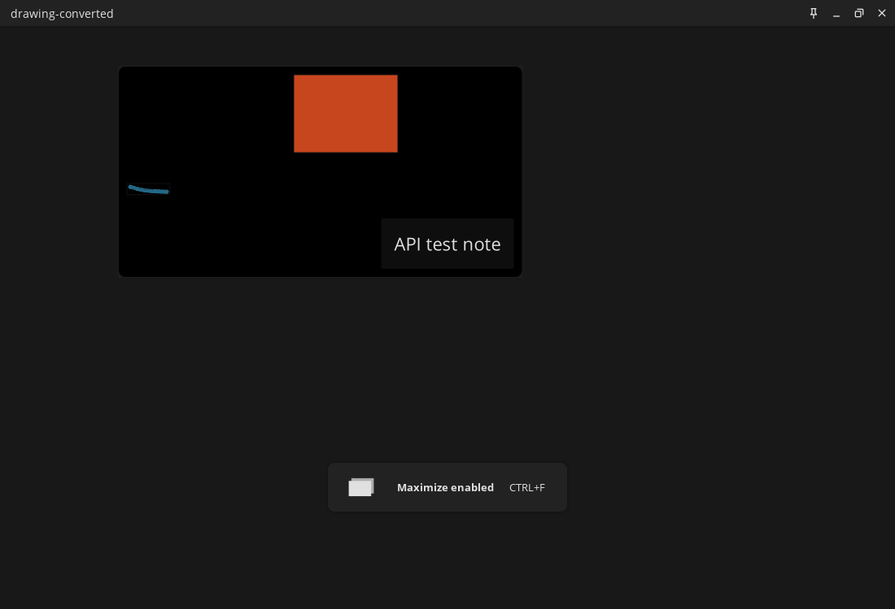

# Validation evidence

Native testing ran in an isolated Linux environment with official PureRef builds.
The automated API/CLI suite currently contains 25 tests. It covers real native
fixtures as well as corruption, invalid edits, Unicode, duplicates, notes,
compatibility conversion, GIF frame selection and host manifests.

| Check | 1.10.4 | 1.11.1 | 2.0.3 | 2.1.3 |
|---|---|---|---|---|
| Application launched and wrote a fixture | Passed | Passed | Passed | Passed |
| Adapter read its native fixture | Passed | Passed | Passed | Passed |
| Edited legacy image/note board opened and rendered | Passed | Passed | Passed | Passed |
| Simplified group/drawing board opened and rendered | Passed | Passed | Passed | Passed |
| Adapter-created modern board opened and rendered | N/A | N/A | Passed | Passed |
| Adapter-edited modern board opened and rendered | N/A | N/A | Passed | Passed |
| Native re-save of pre-copied modern board | N/A | N/A | Passed | Passed |
| GUI Save As of adapter modern board | N/A | N/A | Not separately tested | Passed |

`native-results.json` includes evidence file names, hashes and dimensions.
The fixture directory includes both native sources and converted examples.

## Screenshots

The images below are captures from running PureRef, not UI mockups.

Pillow approximates Qt's antialiasing. The raster image includes transparent
padding; its logical placement and child world transforms are compensated.
The native scene-export dimensions can differ because padding extends the item's
bounds, even while the visible stroke stays at its intended coordinates.

This matrix proves the exercised cases, not every .pur feature or future release.
Real user boards, Windows/macOS native testing and Claude's review remain pending.
